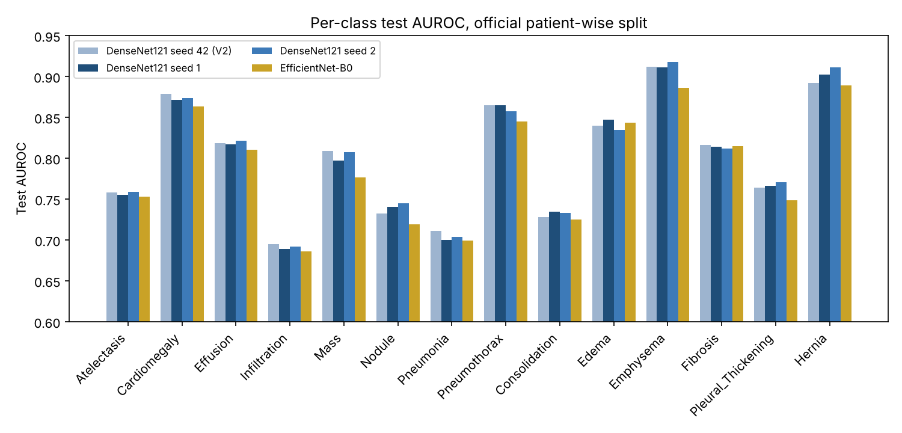
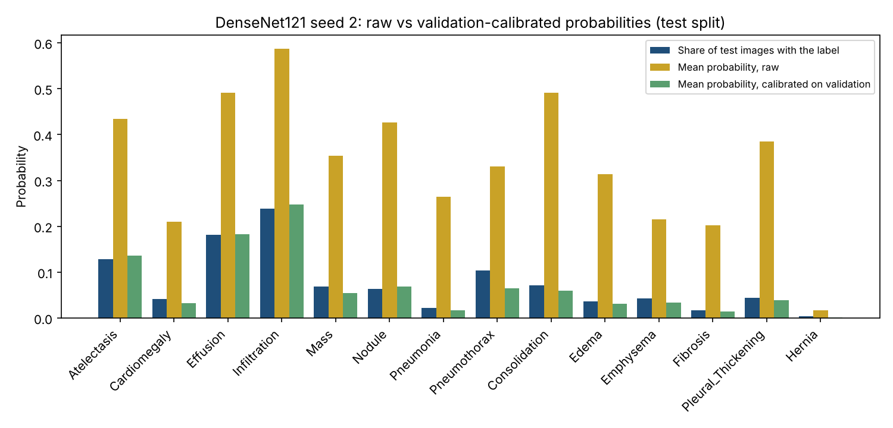
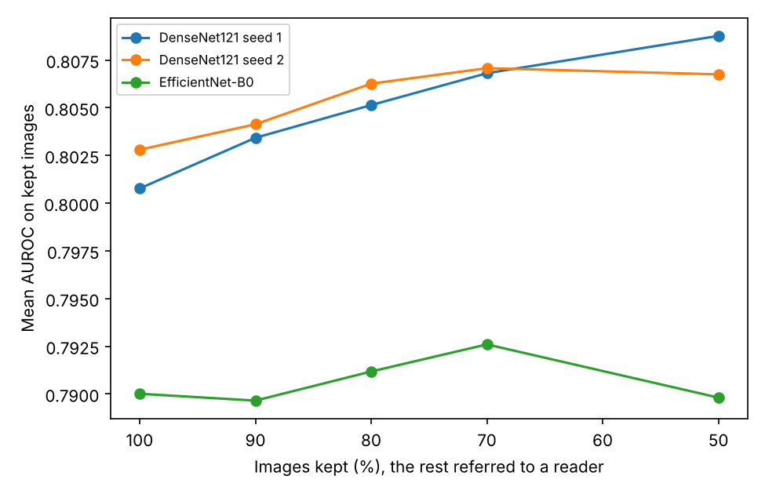
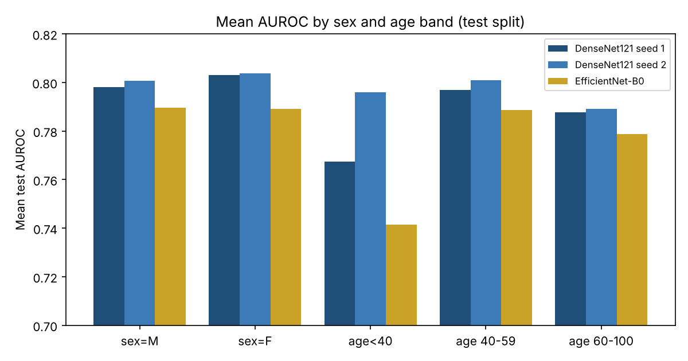
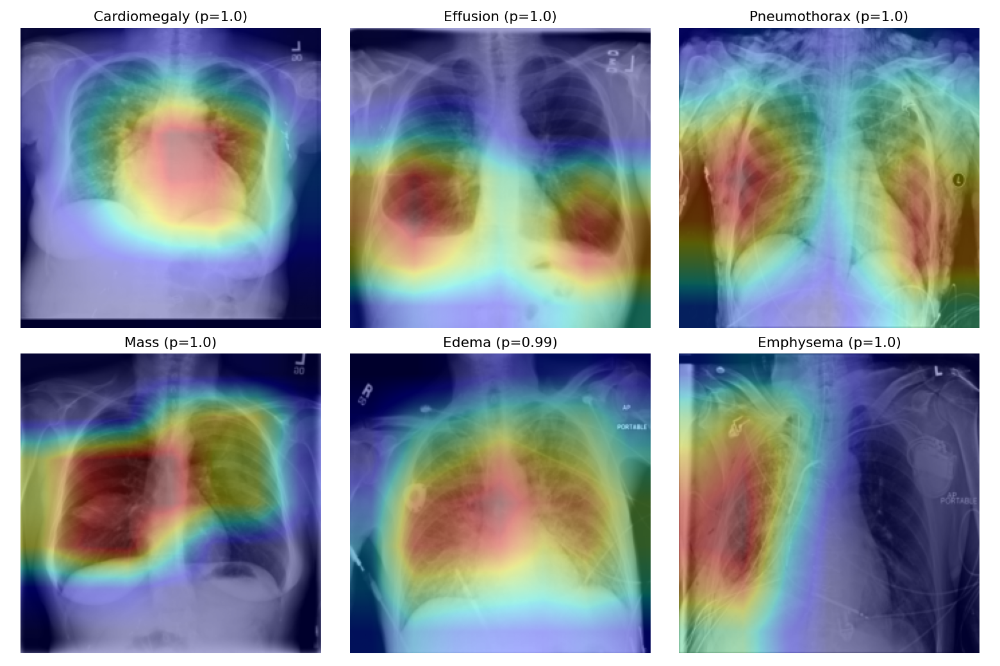
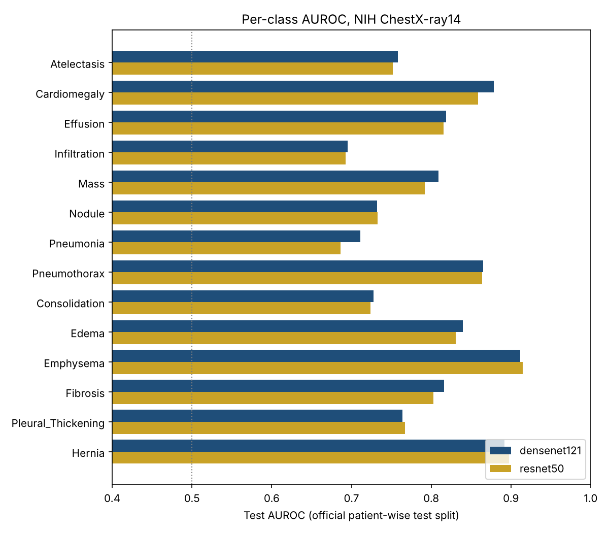
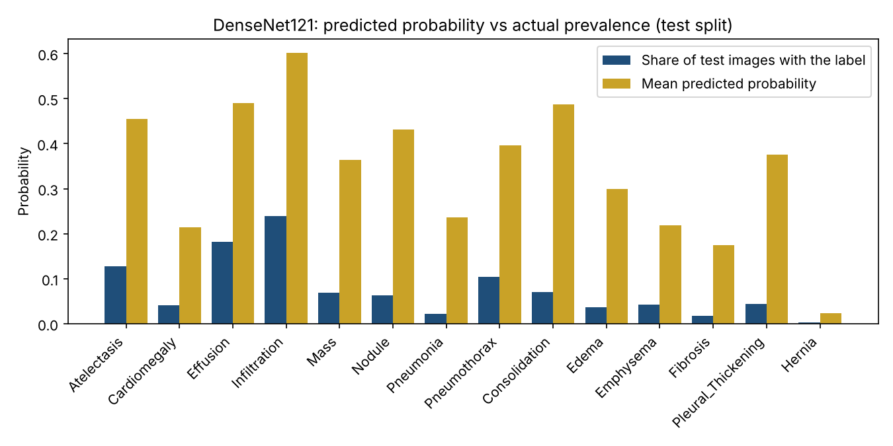

# Lung Disease Classification from Chest X-rays

[](https://doi.org/10.5281/zenodo.23065563)

Multi-label classification of 14 thoracic findings on the **NIH ChestX-ray14** dataset, with a focus on whether the model's probabilities can be trusted, not only on how well it ranks images.

The project started as my MSc project at Glasgow Caledonian University (supervised by Dr. Sajid Nazir) and has since been rebuilt twice:

| Version | Folder | What it is |
|---|---|---|
| V1 | [`Lung_Disease_Classification.ipynb`](Lung_Disease_Classification.ipynb) | Original MSc project code, kept unchanged. Its set-up has known flaws (see below). |
| V2 | [`v2/`](v2/) | First corrected run: 14 labels, official patient-wise split, per-class AUROC, calibration analysis. |
| V2.1 | [`v2.1/`](v2.1/) | Three DenseNet121 seeds, EfficientNet-B0, calibration fitted on the validation set, patient-level intervals, sex and age subgroups, Grad-CAM. **Current version.** |

**[Live demo on Hugging Face](https://huggingface.co/spaces/MHkhan50/chest-xray-14-findings)**: upload a frontal chest X-ray and get calibrated probabilities for 14 findings with a heatmap. It runs entirely in the browser, so the image is never uploaded. Source in [`demo/`](demo/).

> Research code only. Not a medical device and not for diagnosis.

## Main results (V2.1)

All runs use the same data, split and pipeline: ImageNet-pretrained backbone, 224x224 grayscale input, horizontal flips, AdamW (lr 1e-4), batch 128, class-weighted binary cross-entropy, early stopping on validation mean AUROC. Split: 77,719 training, 8,805 validation and 25,596 test images, with no patient in more than one split.

| Model | Test mean AUROC | 95% interval (patient-level bootstrap) | Best validation mean AUROC | Mean ECE, raw → calibrated |
|---|---|---|---|---|
| DenseNet121, seed 42 (V2) | 0.801 | 0.796 to 0.806 (image-level) | 0.831 | — |
| DenseNet121, seed 1 | 0.801 | 0.795 to 0.806 | 0.830 | 0.276 → 0.011 |
| DenseNet121, seed 2 | **0.803** | 0.797 to 0.808 | **0.831** | 0.261 → 0.011 |
| EfficientNet-B0 | 0.790 | 0.784 to 0.795 | 0.824 | 0.291 → 0.011 |
| Average of the three DenseNet121 seeds | **0.814** | not computed | — | — |



## V2.1: seeds, validation-fitted calibration, subgroups and Grad-CAM

- Notebook (Kaggle, T4 GPU, about 4 hours including image caching): [`v2.1/lung-v21-chestxray14.ipynb`](v2.1/lung-v21-chestxray14.ipynb) · [run on Kaggle](https://www.kaggle.com/code/muzammalhussain11/chestx-ray14-v2-1-seeds-calibration-subgroups)
- Saved predictions and Kaggle outputs: [`v2.1/results/`](v2.1/results/), with the age, sex and view of each test image in `test_metadata.csv` (from the NIH metadata)
- Article: [Three training runs, one bug and a sicker test set](https://masmatixinnovations.co.uk/insights/lung-xray-v21-seeds-calibration.html)
- Browser demo export: [`v2.1/chestx-ray14-v2-1-onnx-export.ipynb`](v2.1/chestx-ray14-v2-1-onnx-export.ipynb) converts DenseNet121 seed 2 to ONNX (raw probabilities and class activation maps), checks it against PyTorch, and saves three example test images
- Analysis without a GPU: [`v2.1/analyze_v21.py`](v2.1/analyze_v21.py), which writes [`v2.1/analysis/`](v2.1/analysis/)

### What I found

1. **Seed-to-seed variation is small.** The three DenseNet121 seeds scored 0.801, 0.801 and 0.803 (mean 0.8016, standard deviation 0.0010). Differences between set-ups of less than about 0.003 should not be read as real.
2. **Averaging the three seeds is the cheapest real gain.** The averaged prediction reaches 0.814, about 0.012 above any single seed, at three times the inference cost.
3. **EfficientNet-B0 is faster but weaker.** 0.790 mean AUROC, about 0.012 below DenseNet121, with roughly half the training time (0.39 against 0.70 hours).
4. **Calibration fitted on the validation set works.** Per-class Platt scaling fitted on the 8,805 validation images and checked on the test set brings mean ECE from 0.26–0.29 to 0.011 and mean Brier score from 0.17–0.20 to 0.058, with AUROC unchanged. This replaces V2's check, which fitted and tested on halves of the test set.
5. **Calibration depends on the population.** The official test set is much "sicker" than the validation set: 62% of test images have at least one finding against 43% of validation images, and pneumothorax is 3.4 times as common (10.4% against 3.0%). Calibration still held for most labels, but pneumothorax ended up under-predicted (mean calibrated probability 0.065 against a prevalence of 0.104; ECE 0.041, the worst label). A hospital using a model like this would need to recalibrate on its own patients.
6. **Referring uncertain images helps, but less after calibration.** Keeping the 50% of images with the lowest mean prediction entropy raises DenseNet121 seed 2 from 0.803 to 0.822 with raw probabilities, but only to 0.807 with calibrated ones. For EfficientNet-B0 the calibrated gain is close to zero. Entropy of calibrated probabilities is a weak signal of which images are hard; disagreement between seeds may be a better one (not yet tested).
7. **Age and sex make little difference; an apparent age effect was a counting artefact.** The first subgroup table showed patients under 40 (8,290 test images) as lower and unstable: 0.767, 0.796 and 0.741 mean AUROC. Counting positive cases explained it: the under-40 group contains a single hernia case, so its hernia AUROC is decided by where one image ranks (0.14 to 0.69 across the runs), and that one number moved the 14-label mean. Averaging only over labels with at least 10 positives in the group, patients under 40 score 0.804, 0.804 and 0.788, the same as the whole test set. Men and women are within 0.006 for every model. The oldest band (60 to 100) is the lowest, by about 0.01. Counts: [`v2.1/analysis/subgroup_positives.csv`](v2.1/analysis/subgroup_positives.csv); scores: [`v2.1/analysis/subgroups.csv`](v2.1/analysis/subgroups.csv).
8. **Grad-CAM looks plausible for some labels, not for others.** For cardiomegaly the heatmap sits on the heart and for effusion on the lower lung fields. For pneumothorax it spreads over both lungs instead of the lung edge. Many pneumothorax images in this dataset show a chest drain, and models are known to use the drain as a shortcut; these heatmaps can neither confirm nor rule that out. The six images are the highest-scoring correct case per label, so they show easy cases, not typical ones.









### A bug I found and fixed

In the Kaggle run, the line that sorts images by confidence ended with `[::-1]`, so the referral step kept the *least* confident images and appeared to make results worse (0.801 → 0.771). The saved outputs from that run (`selective_mean_auroc_calibrated` in `summary_v21.json` and `selective_calibrated_v21.csv`) are left as they were for transparency. The notebook line is fixed, and the corrected numbers above come from re-reading the saved predictions with `analyze_v21.py`. A unit test now checks that the most confident images come first. No other result is affected.

### Model choice for a demo

DenseNet121 seed 2 has the highest validation mean AUROC (0.831), so it is the single model to use; it was chosen on validation, not on test. Its per-class calibration parameters, fitted on the validation set, are in [`v2.1/analysis/platt_params.json`](v2.1/analysis/platt_params.json). Model weights are not stored in this repository.

### Limitations of V2.1

- Several seeds only for DenseNet121; EfficientNet-B0 and ResNet50 have one run each.
- Patient-level intervals use 200 bootstrap resamples and cover single models only, not the seed average.
- Subgroup AUROC has no intervals. The Kaggle run's own subgroup file (`results/subgroups_v21.csv`) averages over all 14 labels, including hernia with one positive case under 40; the analysis script reports both versions. Four test images with a recorded age above 100 (data entry errors) fall outside the age bands.
- Still 224x224 input with flips only, labels text-mined from radiology reports, and images from a single hospital.
- Not a medical device and not for diagnosis.

### Reproduce V2.1

1. Training: import `v2.1/lung-v21-chestxray14.ipynb` into Kaggle, add the `nih-chest-xrays/data` dataset, choose a T4 GPU and turn Internet on, then *Save Version, Save & Run All*.
2. Analysis (Mac, Python 3.9+), from the repository root:

```bash
pip install -r v2.1/requirements.txt
cd v2.1
python3 analyze_v21.py
python3 -m unittest discover -s tests
```

## V2: multi-label, patient-wise, per-class AUROC (first corrected run)

V2 fixes the three main problems listed under *Limitations* below: it treats the task as **14 labels** (sigmoid outputs, binary cross-entropy with class weights), uses the **official patient-wise split** (`train_val_list.txt` / `test_list.txt`, with a validation set split by patient), and reports **per-class AUROC** on the official test set.

Article: [I rebuilt my chest X-ray model](https://masmatixinnovations.co.uk/insights/lung-xray-v2-calibration.html) · Kaggle notebook: [ChestX-ray14 V2](https://www.kaggle.com/code/muzammalhussain11/chestx-ray14-v2-multi-label-patient-wise-auroc)

- Models: DenseNet121 and ResNet50, ImageNet-pretrained, same pipeline, 224x224, AdamW (lr 1e-4), batch 128, early stopping on validation mean AUROC.
- Data: 77,719 training, 8,805 validation and 25,596 test images; no patient appears in more than one split (checked in the code).
- Run: one run, seed 42, Kaggle Tesla T4. Training took 47 minutes (DenseNet121) and 42 minutes (ResNet50); both stopped after 7 epochs, with the best weights from epoch 5.

| Model | Test mean AUROC | 95% bootstrap interval | Best validation mean AUROC |
|---|---|---|---|
| DenseNet121 | **0.801** | 0.796 to 0.806 | 0.831 |
| ResNet50 | 0.795 | 0.791 to 0.799 | 0.827 |



Per-class test AUROC (DenseNet121): highest for emphysema (0.912), hernia (0.892) and cardiomegaly (0.879); lowest for infiltration (0.695), pneumonia (0.711) and consolidation (0.728). Full table: [`v2/results/per_class_auroc.csv`](v2/results/per_class_auroc.csv).

### Reliability analysis

`v2/reliability_analysis.py` re-reads the saved test predictions (no GPU needed) and writes [`v2/analysis/`](v2/analysis/).

- **DenseNet121 vs ResNet50.** Paired bootstrap over test images (1,000 resamples): difference +0.006, 95% interval 0.003 to 0.010. The bootstrap resamples images, not patients, so the true interval is probably wider.
- **Calibration.** The raw probabilities are far too high: the mean predicted probability is 2.5 to 10.9 times the share of test images that have each label (for consolidation, 0.49 against 0.07). Mean expected calibration error (ECE) is 0.265. The class weights used in training are the likely cause. Per-class Platt scaling, fitted on one half of the test images and applied to the other, brings mean ECE to 0.005 and mean Brier score from 0.175 to 0.058, with mean AUROC unchanged (0.801).
- **Referral of uncertain images.** Keeping the 50% of images with the lowest prediction entropy and referring the rest raises DenseNet121 mean AUROC from 0.801 to 0.816 (0.805 at 90% kept, 0.811 at 70%). This used the raw, uncalibrated probabilities.



### V1 vs V2

| | V1 (MSc) | V2 |
|---|---|---|
| Task | 836 label combinations (MobileNet, VGG16) or binary (ResNet-50) | 14 labels, multi-label |
| Split | random by image (patient leakage) | official, by patient |
| Metric | accuracy (58.1% validation) | per-class AUROC (0.801 mean, test) |
| Models comparable | no | yes, same data and pipeline |

The V1 and V2 numbers measure different things and cannot be compared directly. V2 is the first result from this project that can be trusted.

### My notes

- Infiltration (0.695), pneumonia (0.711) and consolidation (0.728) had the lowest AUROC. On an X-ray all three appear as white opacity where air should be, so they overlap visually. The labels were also mined from report text, which may be least reliable for these three. My guess is that the image alone is not enough and clinical information would help, but I have not tested that.
- For a clinician, wrong percentages can be more harmful than a lower AUROC. Before recalibration the average predicted probability for consolidation was 49% while only 7% of test images had it, so almost every image would raise an alarm. After Platt scaling the mean ECE fell from 0.265 to 0.005 with AUROC unchanged, so any demo or app has to show recalibrated values.
- V1 reported 58% accuracy on 836 label combinations with a random image split. V2 treats the task as 14 labels, splits by patient and reports per-class AUROC. The class weights I added in V2 helped the rare labels during training, but they are also what inflated the probabilities, so that choice needs a calibration step after it.

### Limitations of V2

- One run and one seed per model; differences of a few thousandths may change with another seed.
- 224x224 grayscale images and horizontal flips only; no higher resolution or stronger augmentation.
- The recalibration was fitted and checked on halves of the official test set, split by image, not by patient. A clean version fits it on the validation set.
- NIH labels were extracted from radiology reports by text mining and contain errors. All images come from one hospital, so results may not transfer to other sites.
- Not a medical device and not for diagnosis.

V2.1 addresses the first and third points: two more seeds, and calibration fitted on the validation set.

### Reproduce V2

1. Training: import `v2/lung-v2-chestxray14.ipynb` into Kaggle, add the `nih-chest-xrays/data` dataset, choose a GPU and turn Internet on, then *Save Version, Save & Run All*. Set `SMOKE = True` first for a ten-minute check.
2. Analysis (Mac, Python 3.9+): `pip install -r v2/requirements.txt`, then `cd v2 && python3 reliability_analysis.py --results results --out analysis` and `python3 -m unittest discover -s tests`.

Model weights are not stored in this repository.

## V1 (MSc project): dataset and experiments

### Dataset

- **Source:** [NIH Chest X-rays on Kaggle](https://www.kaggle.com/datasets/nih-chest-xrays/data) (Wang et al., 2017)
- 112,120 frontal chest X-rays from 30,805 patients, labelled with up to 14 thoracic pathologies or "No Finding"
- The images (~42 GB) are **not included** in this repository; the notebook downloads them via the Kaggle API.

### Experiments

| Model | Framework | Task set-up | Data used | Train acc. | Val. acc. |
|---|---|---|---|---|---|
| ResNet-50 (fine-tuned) | PyTorch | Binary: any finding vs. "No Finding" | 11,000-image random sample (10,000 / 1,000 split) | 95.4% | 64.1% |
| MobileNet (frozen base) | Keras | Each label combination treated as a class (836 classes) | Full dataset (80/20 split) | 52.9% | 58.1% |
| VGG16 (frozen base) | Keras | Each label combination treated as a class (836 classes) | Full dataset (80/20 split) | 52.8% | 58.1% |

Training curves for each model are plotted inside the notebook.

## V1 limitations and next steps

Looking back at this work, several issues limit how far the numbers above can be trusted. I list them here openly because fixing them is the basis of the follow-up project.

1. **Wrong problem framing for MobileNet/VGG16.** ChestX-ray14 is a *multi-label* dataset (one image can show several diseases). Treating every label combination as its own class produced 836 classes and a softmax output; the ~58% validation accuracy is close to what a model gets by predicting "No Finding" for every image. The correct set-up is 14 sigmoid outputs with binary cross-entropy.
2. **Accuracy is the wrong metric.** With imbalanced classes, accuracy hides failure on rare diseases. The standard for this dataset is **per-class AUROC**.
3. **Overfitting in ResNet-50.** Training accuracy reached 95% while validation accuracy stayed near 64% and validation loss rose after the early epochs. Early stopping and stronger regularisation are needed.
4. **Patient leakage.** Splits were made by image, not by patient, so X-rays of the same person can appear in both training and validation. The dataset's official patient-wise split (`train_val_list.txt` / `test_list.txt`) should be used.
5. **Models are not directly comparable**, since ResNet-50 was trained on a different task and data subset from MobileNet and VGG16.

All five are addressed in V2 (item 3 through early stopping). EfficientNet, Grad-CAM and sex and age subgroup results followed in V2.1. Still open: MobileNet in the same pipeline and a chest X-ray foundation model as a comparison.

## How to run V1

The notebook was developed on **Google Colab with a GPU**, which is the recommended way to run it.

1. Open `Lung_Disease_Classification.ipynb` in Google Colab and select a GPU runtime.
2. Create a Kaggle API token (Kaggle → Settings → *Create New Token*) and upload the downloaded `kaggle.json` to the Colab session. **Never commit this file to GitHub.**
3. Run the cells in order. The dataset download and unzip take a while (~42 GB).

To run locally instead:

```bash
python3 -m venv venv
source venv/bin/activate        # Windows: venv\Scripts\activate
pip install -r requirements.txt
jupyter notebook
```

## References

- Wang, X. et al. (2017). *ChestX-ray8: Hospital-scale chest X-ray database and benchmarks on weakly-supervised classification and localization of common thorax diseases.* CVPR.
- Rajpurkar, P. et al. (2017). *CheXNet: Radiologist-level pneumonia detection on chest X-rays with deep learning.* arXiv:1711.05225.
- Huang, G. et al. (2017). *Densely connected convolutional networks.* CVPR.
- He, K. et al. (2016). *Deep residual learning for image recognition.* CVPR.
- Tan, M. & Le, Q. (2019). *EfficientNet: Rethinking model scaling for convolutional neural networks.* ICML.
- Howard, A. G. et al. (2017). *MobileNets: Efficient convolutional neural networks for mobile vision applications.* arXiv:1704.04861.
- Simonyan, K. & Zisserman, A. (2015). *Very deep convolutional networks for large-scale image recognition.* ICLR.
- Platt, J. (1999). *Probabilistic outputs for support vector machines and comparisons to regularized likelihood methods.* Advances in Large Margin Classifiers.
- Guo, C. et al. (2017). *On calibration of modern neural networks.* ICML.
- Selvaraju, R. R. et al. (2017). *Grad-CAM: Visual explanations from deep networks via gradient-based localization.* ICCV.
- Oakden-Rayner, L. et al. (2020). *Hidden stratification causes clinically meaningful failures in machine learning for medical imaging.* ACM CHIL.

## Author

**Muzammal Hussain**, Software Engineer, Data Scientist and AI Researcher

- GitHub: [MHKhan50](https://github.com/MHKhan50)
- Kaggle: [muzammalhussain11](https://www.kaggle.com/muzammalhussain11)

## Citation

If you use this code, please cite it (GitHub's *Cite this repository* button uses [`CITATION.cff`](CITATION.cff)):

> Hussain, M. (2026). *Lung Disease Classification from Chest X-rays* (Version v2.1.1) [Computer software]. Zenodo. https://doi.org/10.5281/zenodo.23065563
